<p align="center">
  
</p>

<h1 align="center">甬轨通</h1>

<p align="center">宁波地铁出行助手 · 下一班几分钟到、换乘要不要赶，打开就知道</p>

## 能做什么

- **下一班几分钟到**：常用车站直接显示每个方向的下一班，倒计时实时走，按设置定时刷新。在「我的 → 数据与刷新 → 到站倒计时显示」可选分钟或分秒（如 `02:15`），应用内首页、到站页和线网站点卡片同步生效并记住选择；桌面小组件与实时通知仍显示分秒。到站后显示「停靠中」及接口给出的发车时刻，发车后才切到下一班；不是统一加固定停站时间。
- **换乘要不要赶**：收藏一条路线，按“现在出发”推算到换乘站的时间，直接告诉你 **不用赶 / 需要赶 / 可能赶不上**，赶不上还会给出下一班。
- **一屏看懂线网**：九条线路的示意线网图，双指缩放、按线路筛选，点车站就能看到站时间。
- **怎么搜都行**：中文站名、拼音、站点编码、“2号线”都能搜。
- **行程估算**：选起点和终点，给出换乘方案和大致用时。
- **收藏与深色模式**：常用站、常用路线一键收藏；支持浅色 / 深色 / 跟随系统。
- **桌面小组件（Android）**：不用打开 App，桌面上直接看收藏车站各方向的下一班和倒计时；点站名切换收藏的车站，点卡片进入到站页。在「我的 → 添加桌面小组件」一键添加。
- **状态栏实时更新 / 超级岛（Android）**：在到站页点某个方向的铃铛「等这班车」，或在行程估算里点「开始行程」，即可查看倒计时。等车提醒到站后切换为「停靠中」及发车倒计时，离站时结束；行程按上车、乘车、换乘和预计到达切换。系统允许焦点通知时附带小米原生超级岛计时参数；无论是否获得权限，胶囊短文本均逐秒更新，原生超级岛也同步提供当前数字，不假定系统会自行计时。具体展示受机型、系统版本与权限限制，尚未在小米真机验证；其他系统显示常驻通知。

## 截图

<table>
  <tr>
    <td align="center">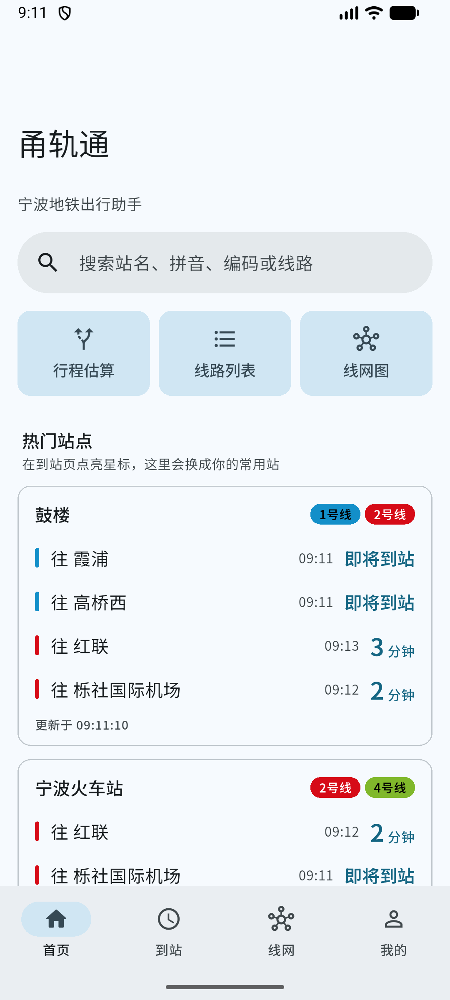<br>首页：常用站的下一班</td>
    <td align="center">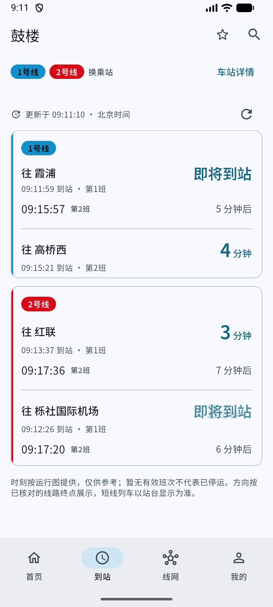<br>到站：各线路、各方向</td>
    <td align="center">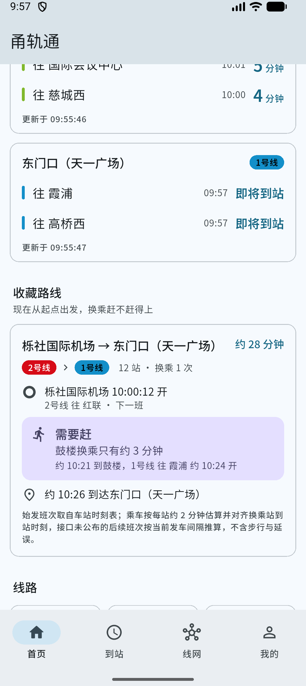<br>收藏路线：换乘要不要赶</td>
  </tr>
  <tr>
    <td align="center">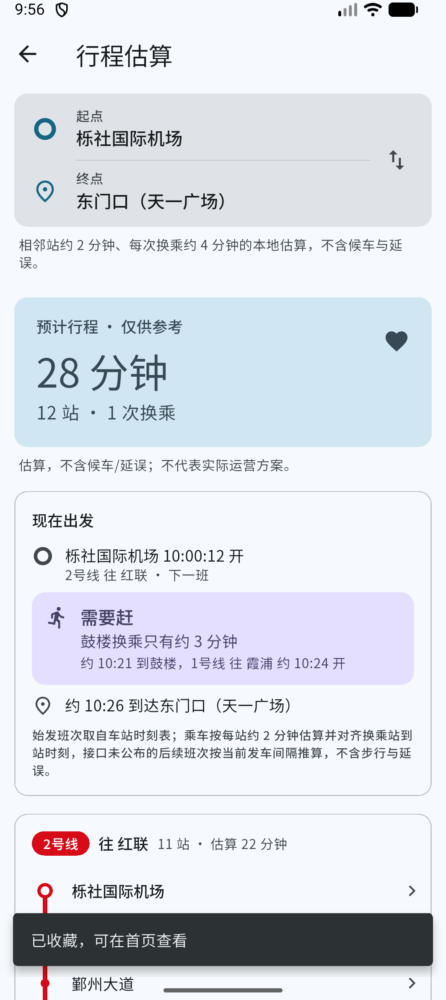<br>行程估算：现在出发</td>
    <td align="center">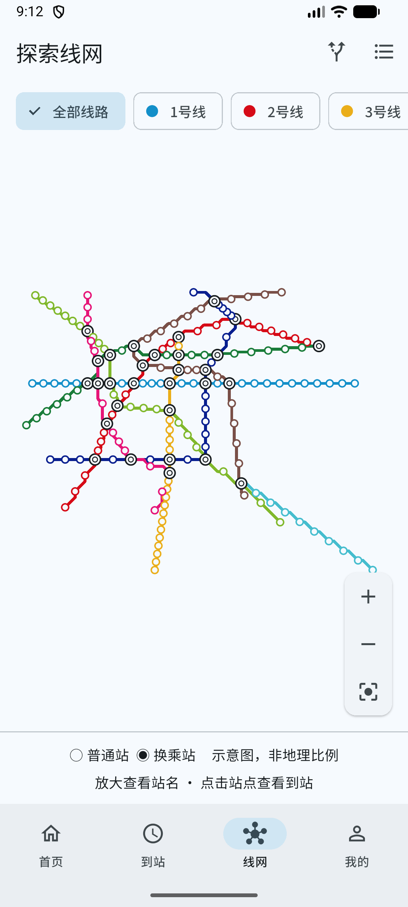<br>线网图</td>
    <td align="center">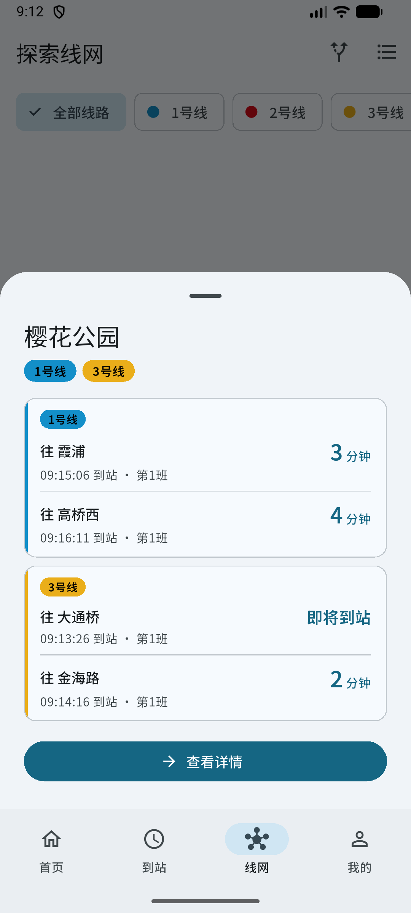<br>点站看到站</td>
  </tr>
  <tr>
    <td align="center">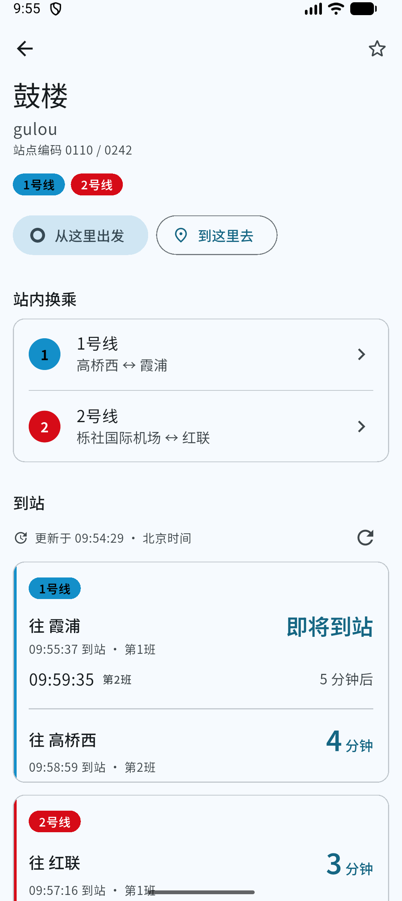<br>车站详情</td>
    <td align="center">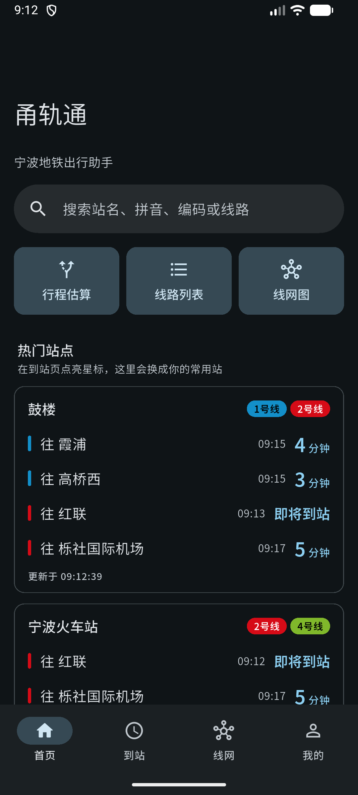<br>深色模式</td>
    <td align="center">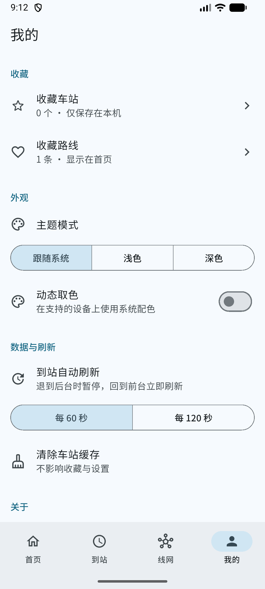<br>我的</td>
  </tr>
</table>

<p align="center">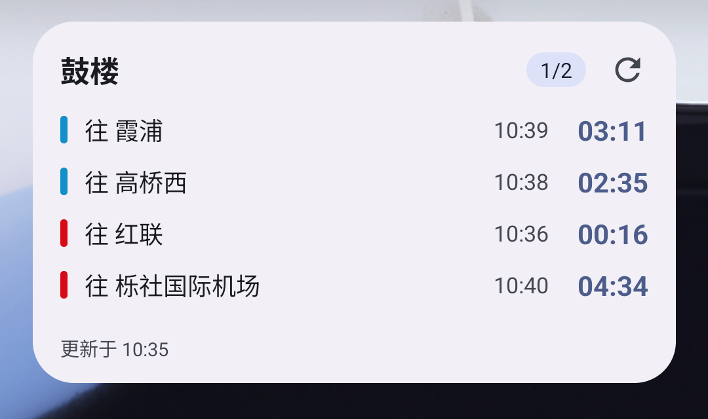<br>Android 桌面小组件：收藏车站各方向的下一班，点站名切换车站</p>

<p align="center"> 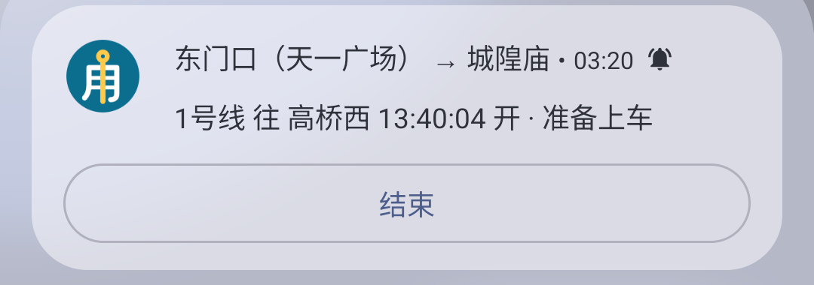<br>状态栏实时更新：胶囊倒计时到下一步，通知里写着换乘要不要赶</p>

## 安装

**Android**：到本仓库的 Releases 页面下载最新版本，在手机上打开安装即可。绝大多数手机下载 `…-arm64-v8a.apk`；很老的 32 位手机用 `…-armeabi-v7a.apk`；不确定就下 `…-universal.apk`（体积最大，所有手机都能装）。

**自己编译**（Android / iOS）：安装 [Flutter](https://docs.flutter.dev/get-started/install)（stable）后，连接手机或打开模拟器，在项目目录运行

```sh
flutter pub get
flutter run
```

不需要注册账号或任何密钥。

## 版本更新

### v1.3.1

- 修复部分系统复用通知时旧数据覆盖新数据，导致胶囊数字停在初始值的问题。
- 获得超级岛权限后仍逐秒刷新胶囊文字和原生数字；修正原生计时总时长，阶段切换后替换计时目标，到时清除旧倒计时。
- 增加 Android 14 / 16 原生回归检查，覆盖有无超级岛权限、停靠切换和计时结束，并接入发布流程。已在 Android 模拟器验证正式包后台倒计时；小米 17 / HyperOS 4.0.6.0 的实际展示仍需真机确认。

### v1.3.0

- 新增到站倒计时「分钟 / 分秒」设置，应用内同步生效并记住选择。
- 修复列车停靠期间提前切到下一班：按接口发车时刻保留当前列车，首页、到站页、桌面小组件、行程选车和等车通知同步修正。
- 改进小米超级岛兼容：系统允许时发送原生计时参数，否则保留实时通知及逐秒胶囊文字。尚未在小米真机验证，实际展示受系统和权限限制。
- 修复从「到站」进入站点后按返回直接退出应用的问题；收藏、搜索和外部链接打开的站点到站页均可返回到站列表。

## 说明

- 到站数据来自宁波地铁官方；时刻仅供参考，请以车站现场信息为准。
- 行程用时和换乘提醒是估算，不含步行和延误。
- 「停靠中」及发车倒计时依据接口时刻表，不代表检测到开门或实际离站；延误时以站台显示为准。桌面小组件的后台刷新由系统调度，可能延迟。
- 小米超级岛实现参考 GitHub 的 [HyperIsland ToolKit](https://github.com/D4vidDf/HyperIsland-ToolKit) 和 [HyperBridge](https://github.com/D4vidDf/HyperBridge)。部分国行系统仍会限制第三方焦点通知；本应用不使用 Root / Shizuku，也不通过阻断小米推送服务联网来绕过限制。
- 线网图是示意图，不按实际地理比例绘制。
- 不需要登录，不收集个人信息；收藏和设置只保存在你的手机上。
- 本应用为个人开发，不是宁波地铁官方产品。

<details>
<summary>开发者</summary>

- 测试：`flutter analyze`、`flutter test`（离线，使用保存的真实接口样本）；Android 原生通知回归检查：构建 APK 后在 `android` 目录运行 `./gradlew :app:testDebugUnitTest`。每次推送和 PR 由 GitHub Actions 自动运行，并构建 Android 安装包。
- 发布：推送 `v1.2.3` 这样的标签，Actions 会构建 APK 并发布到 Releases。要用固定签名（方便用户覆盖升级），在仓库 Secrets 中配置 `ANDROID_KEYSTORE_BASE64`、`ANDROID_KEYSTORE_PASSWORD`、`ANDROID_KEY_ALIAS`、`ANDROID_KEY_PASSWORD`；不配置时使用临时调试签名。
- 应用图标源文件是 `assets/brand.svg`，修改后运行 `tool/render_icons.sh`（macOS，需 Chrome）重新生成各平台图标。
- 中文字体 Noto Sans SC 随应用打包，许可见 `assets/fonts/OFL.txt`。

</details>

## 许可

[MIT](LICENSE)
